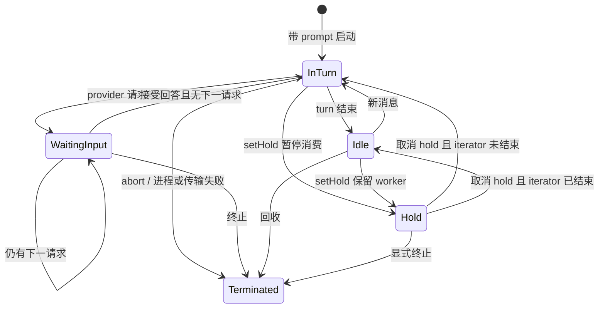

# 数据、标识与状态

[返回总览](README.md)。本页描述实际来源与 writer；“原生会话是基础数据”不等于“Yep 不写数据”，也不等于所有状态都能从一个 JSONL 恢复。

## 核心对象与关联

| 对象 | 标识/关联 | 来源及注意事项 |
| --- | --- | --- |
| 安装实例 | `installId` | `InstallService` 持久化；客户端 server-scoped key 使用它隔离服务器数据。不同于 browser profile ID |
| 项目 | `UrlProjectId`、绝对 `path` | URL ID 是路径的 base64url；`DirProjectId` 是历史目录编码，丢失信息，不能直接反解。项目可能合并多 provider 会话 |
| 会话 | provider 原生 `sessionId`；Codex 对应 thread ID | resume/fork 可能产生新 ID；`Supervisor.sessionToProcess`、metadata alias/remap、客户端路由需要一起跟随 |
| 进程 | `processId` → session/project | 当前 resident worker 身份；一个历史 session 不必有进程。进程结束不等于历史删除 |
| 消息/乐观输入 | `uuid`、`id`；`tempId`、`clientUserMessageId` | 原生消息身份、前端乐观身份、provider echo 关联不同；不能用列表下标替代。跳过空白身份用 [message-id.ts](../../packages/shared/src/message-id.ts) `nonEmptyMessageId`；保留空白字符串用 `stringMessageId`。`uuid ?? id` 仍留在分页、inspector、文件活动和标题上下文里，因为非字符串 uuid 会挡住 id |
| 原生 turn/item / 分支 | `turnId`、item ID、`branchId`、`forkParentSessionId` | 同 session 的历史分支与新 session 的 fork family 不同。Codex 编辑的“排除后续 turn 数”仍使用请求字段 `rollbackNumTurns` |
| 输入请求与审批操作 | `requestId`；`operationId + version`；原生 turn/item 坐标 | request 可能在 process/bridge 形成别名；broker 通过操作身份协调并发。折叠成 `tool-approval` / `user-question` 时只用 [session-runtime.ts](../../packages/server/src/sessions/session-runtime.ts) `pendingInputTypeFromRequest`。基础 Web API 仍只发 requestId，服务端补齐当前操作身份 |
| 队列 | `queueId` 与 position | worker admission 队列不同于某一进程的 pending/deferred message 队列；未开始时可能没有最终 session ID |
| 显示视图 | `view.sessionId + branchScopeId + epoch`、`seq/baseSeq` | 是传输/投影版本；不可与 provider turn 序号或 journal sequence 比大小。工具合集可带 `durationMs` 与 `timedCount`，来自步骤上的 `durationMs` 或起止时间差；缺可靠起止时字段省略，不能用 reducer 处理耗时补零 |
| 上传/文件证据 | upload ID、project/session、snapshot/content hash、operation 身份 | 上传文件、当前工作区文件、历史内容 blob 分别保存；一条工具记录不必有完整内容快照 |

对应证据：[packages/shared/src/projectId.ts](../../packages/shared/src/projectId.ts) `UrlProjectId/DirProjectId/toUrlProjectId`；[packages/server/src/supervisor/Supervisor.ts](../../packages/server/src/supervisor/Supervisor.ts) `sessionToProcess/registerProcess`；[packages/server/src/metadata/SessionMetadataService.ts](../../packages/server/src/metadata/SessionMetadataService.ts) `remapSessionId/resolveSessionId`；[packages/client/src/lib/mergeMessages.ts](../../packages/client/src/lib/mergeMessages.ts) `getMessageId`；[packages/shared/src/session-display.ts](../../packages/shared/src/session-display.ts) 显示 schema；[packages/client/src/api/client.ts](../../packages/client/src/api/client.ts) `respondToInput`。

## 持久化与写入责任

下面的 `<dataDir>` 由 [packages/server/src/config.ts](../../packages/server/src/config.ts) `getDataDir` 决定：显式 `YEP_ANYWHERE_DATA_DIR` 优先，其次 `~/.yep-anywhere-{profile}`，最后 `~/.yep-anywhere`。只展示结构，不展示本机数据内容。

| 数据 / 默认位置 | 真实 writer | 主要 reader / 冲突或失效规则 |
| --- | --- | --- |
| Claude projects JSONL、Codex rollout JSONL、Gemini session、Pi session tree | 原生 CLI/runtime；Yep 另有 clone、archive 等操作可写或移动这些数据 | 各 `ISessionReader`、scanner、索引。provider 仍在写时可能只读到部分历史 |
| Cursor `~/.cursor/acp-sessions/<id>/{meta.json,store.db}` | 原生 Cursor | `readCursorSessionDir` 遍历 blob/protobuf 历史；不同于 JSONL；compaction 和重复 prompt 有专门处理 |
| `<dataDir>/session-metadata.json`、`project-metadata.json` | `SessionMetadataService`、`ProjectMetadataService` | 标题、置顶、归档、provider/账号/网关选择、来源、分叉关系；metadata overlay 可覆盖原生标题 |
| `<dataDir>/indexes/`、`indexes/content/` | `SessionIndexService`、`SessionContentIndexService` | 前者服务摘要列表，后者全文；临时文件 + rename、锁及缓存失效。不能以旧 index 的状态覆盖活跃 runtime |
| `<dataDir>/notifications.json` | `NotificationService.markSeen/markSessionNeedsReview/clearSession` 等 | `lastSeen` 与 `needsReview` 分开；启动还会从 recents 回填缺失已读记录；多客户端共享服务端口径 |
| `<dataDir>/recents.json` | `RecentsService.recordVisit` | 最近访问顺序、项目定位、已读迁移；不等价于 transcript 最新活动时间 |
| `<dataDir>/runtime/events/<processId>.jsonl` 及轮转段 | `RuntimeEventStore.append`，由 Embedded controller 订阅 Process 后写 | shell 断连补播、display 恢复；按进程记录，与原生历史并存；`YEP_RUNTIME_EVENT_JOURNAL=0` 可关闭 |
| `<dataDir>/codex-events/events.jsonl`，可环境覆盖 | Codex provider 的 `CodexEventIngress` → `CodexEventStore` | canonical projection/transcript；journal mode 决定保留内容，不保证包含所有 delta 或完整前缀 |
| `<dataDir>/codex-bridge/codex-events.jsonl` 等 bridge 数据 | `CodexBridgeJournal` / `CodexBridgeService` | legacy full journal 可成为 canonical 读取来源；bridge 自身持久化还包括会话观测信息。不要把不同 journal 的 sequence 全局排序 |
| `<dataDir>/interactions/operations.json` | `InteractionBroker` | 持久化 CAS 状态/操作身份；provider resolver 回调只在内存。重启对 open/answering 的恢复采用 fail closed 处理 |
| `<dataDir>/uploads/<project>/<session>/...` | `UploadManager`；浏览器上传、Feishu 媒体和生成物走相应入口 | provider prompt 引用、客户端预览；校验路径 containment、大小与上传状态 |
| `<dataDir>/session-file-snapshots/` | `SessionFileLifecycle` + `SessionFileStore` | 执行边界 before/after/checkpoint、record 和内容 hash；有 full/partial coverage；不宣称进程级文件归因 |
| `<dataDir>/session-file-operations/` | provider 文件事件、历史导入 → `SessionFileOperationStore` | 工具操作索引、diff、详情；display 的历史导入也会写派生记录，多来源需要去重 |
| `<dataDir>/archive/manifest.json` 与归档内容 | `SessionArchiveService.archiveSession/restoreSession` | 文件 provider 移动文件，SQLite provider 更新原库状态；另有 metadata 的 archived 字段，需要协调 |
| `<dataDir>/channels/feishu/` | inbox、binding、operation、secret/user-auth 等 store | 入站幂等/恢复、会话绑定、操作及授权；具体敏感内容未读取 |
| auth/settings/browser/install/push JSON | 各服务：AuthService、ServerSettingsService、BrowserProfileService、InstallService、PushService、NativePushService | 控制与通知配置，非会话业务数据；含敏感字段的文件不应复制进地图 |
| reportsDir、`<dataDir>/report-comments.json`（无 dataDir 时用报告根目录下文件）与 Worker/R2 | `createReportsRoutes`；`SharingService.uploadHtml` → Worker `fetch` PUT | 报告/评论/图片与分享 HTML 独立于会话存储；外部分享写入需显式业务动作 |
| 客户端 localStorage | `useDraftPersistence`、`useDraftAttachments`、`storageKeys`、theme/font hooks | 草稿、已上传附件引用、显示偏好；草稿不是成功提交的证据，也不天然跨设备同步 |

存储证据：

- provider 路径与读取：[projects/codex-scanner.ts](../../packages/server/src/projects/codex-scanner.ts) `CODEX_SESSIONS_DIR`；[projects/gemini-project-map.ts](../../packages/server/src/projects/gemini-project-map.ts) `GEMINI_TMP_DIR`；[sessions/pi-files.ts](../../packages/server/src/sessions/pi-files.ts) `PI_SESSIONS_DIR/PI_SESSION_DIR_IS_EXACT`；[sessions/cursor-reader.ts](../../packages/server/src/sessions/cursor-reader.ts) `CURSOR_ACP_SESSIONS_DIR`；[sessions/cursor-store.ts](../../packages/server/src/sessions/cursor-store.ts) `readCursorSessionDir`。
- 服务自有状态：[metadata/SessionMetadataService.ts](../../packages/server/src/metadata/SessionMetadataService.ts) `constructor/doSave`；[indexes/SessionIndexService.ts](../../packages/server/src/indexes/SessionIndexService.ts) 与 [SessionContentIndexService.ts](../../packages/server/src/indexes/SessionContentIndexService.ts) 的索引路径及 rename；[notifications/NotificationService.ts](../../packages/server/src/notifications/NotificationService.ts) `constructor/importLastSeenFromRecents/doSave`；[recents/RecentsService.ts](../../packages/server/src/recents/RecentsService.ts) `recordVisit`。
- 事件来源：[runtime/RuntimeEventStore.ts](../../packages/server/src/runtime/RuntimeEventStore.ts) `append/replay`；[runtime/standalone.ts](../../packages/server/src/runtime/standalone.ts) journal 开关；[routes/codex-transcript.ts](../../packages/server/src/routes/codex-transcript.ts) `createDefaultCodexTranscriptStoreSources`；[codex-events/store.ts](../../packages/server/src/codex-events/store.ts) `CodexEventStore`；[codex-events/ingress.ts](../../packages/server/src/codex-events/ingress.ts) `CodexEventIngress`。
- 写入协调：[interactions/InteractionBroker.ts](../../packages/server/src/interactions/InteractionBroker.ts) `initialize/register/resolve`；[session-files/lifecycle.ts](../../packages/server/src/session-files/lifecycle.ts) `begin/bind`；[session-files/operation-store.ts](../../packages/server/src/session-files/operation-store.ts) `SessionFileOperationStore`；[archive/SessionArchiveService.ts](../../packages/server/src/archive/SessionArchiveService.ts) `archiveSession`。
- 通道与客户端：[channels/feishu/inbox.ts](../../packages/server/src/channels/feishu/inbox.ts) `FeishuDurableInbox`；[binding-store.ts](../../packages/server/src/channels/feishu/binding-store.ts) `FeishuBindingStore`；[packages/client/src/lib/storageKeys.ts](../../packages/client/src/lib/storageKeys.ts) `UI_KEYS/SERVER_SCOPED_KEYS`；[useDraftPersistence.ts](../../packages/client/src/hooks/useDraftPersistence.ts) `useDraftPersistence`。

## 状态不是一个枚举

这是 `Process` 的代表转换，省略 create-only 初始等待、队列及 provider 特定分支，并非完整自动机。源码：[supervisor/types.ts](../../packages/server/src/supervisor/types.ts) `ProcessState`；[supervisor/Process.ts](../../packages/server/src/supervisor/Process.ts) `setState` 与 waiting-input/idle/hold 转换。

另有四个正交维度：

1. `ownership = none/self/external` 表示谁控制会话；`idle` resident process 仍可归 self。`deriveSessionRuntime` 组合 `isBusy/hasResidentWorker/canArchive`，不能用是否有 process 判断能否归档。[sessions/session-runtime.ts](../../packages/server/src/sessions/session-runtime.ts) `deriveSessionRuntime`。
2. `lastTurnStatus/retryStatus` 是回合结果/重试信息，不等于进程是否存活；display 还维护自己的 activity。消息错误不能仅凭最后一个 result 的存在推断成功。[shared/app-types.ts](../../packages/shared/src/app-types.ts) `SessionRuntime/SessionLastTurnStatus`；[display/SessionDisplayReducer.ts](../../packages/server/src/display/SessionDisplayReducer.ts) `SessionDisplayReducer`。
3. `lastSeen/hasUnread/needsReview` 与 pending input 无等价关系；badge 当前来自 needsAttention 集合，另有 finishedUnreadCount。[routes/inbox.ts](../../packages/server/src/routes/inbox.ts) `createInboxRoutes`，见 F5。
4. display 的 epoch/sequence 与历史 cursor/revision 用来拒绝过时结果；跨 session、branch 或 epoch 不合并。[packages/shared/src/session-display.ts](../../packages/shared/src/session-display.ts) `applySessionDisplayPatch`。

## 多来源、覆盖与缓存

| 同时存在的事实 | 当前处理 | 修改时检查 |
| --- | --- | --- |
| 原生历史 + live 消息 | display 先挂运行订阅，再读历史，overlay 留在服务端；轮询补文件历史 | 不把尚未落盘 live tail 被空历史覆盖；也不让旧 replay 复活已完成工具 |
| provider journal + bridge journal + rollout | canonical source 选择和 coverage；legacy session endpoint 可回退 rollout | 不把 canonical 当完整历史保证；不同 journal 的 sequence 无共同全局顺序 |
| process pending input + bridge pending input | process 有匹配请求优先，否则查 bridge；broker 合并身份 | 仅查 self ownership 会漏掉 bridge 持有的审批 |
| provider 标题 + AI/custom 标题 | metadata overlay；custom/AI 覆盖原生派生标题 | 新 writer 必须保留标题优先级，不直接用最新事件覆盖全部 |
| archived metadata + archive manifest + 原生库/文件 | metadata API 先校验 runtime，再执行物理/库归档，再更新相关状态 | 多步不是一个数据库事务；中途失败与恢复需单独验证 |
| HTTP snapshot + WS patch + 客户端 cache | epoch/seq 校验，gap 触发 snapshot 重取；旧响应隔离 | cache 只用于恢复显示，不是发送成功或 provider 完成凭证 |

证据分别见 [SessionDisplayService.ts](../../packages/server/src/display/SessionDisplayService.ts) `initialize/refresh/poll`、[routes/sessions.ts](../../packages/server/src/routes/sessions.ts) canonical fallback 与 metadata handler、[SessionInteractionService.ts](../../packages/server/src/interactions/SessionInteractionService.ts) `selectPendingInputOwner`、[useProjectedSessionMessages.ts](../../packages/client/src/hooks/useProjectedSessionMessages.ts) `handleDisplayEvent/refreshSessionMessages`。

持久化实现并不统一：notification/metadata 使用串行或合并保存但直接 `writeFile`；index、broker 等路径使用原子 JSON 写或 rename。原子替换、进程内串行、跨进程锁是不同保证。本次没有做磁盘故障/多 writer 实验，风险候选见 findings。
