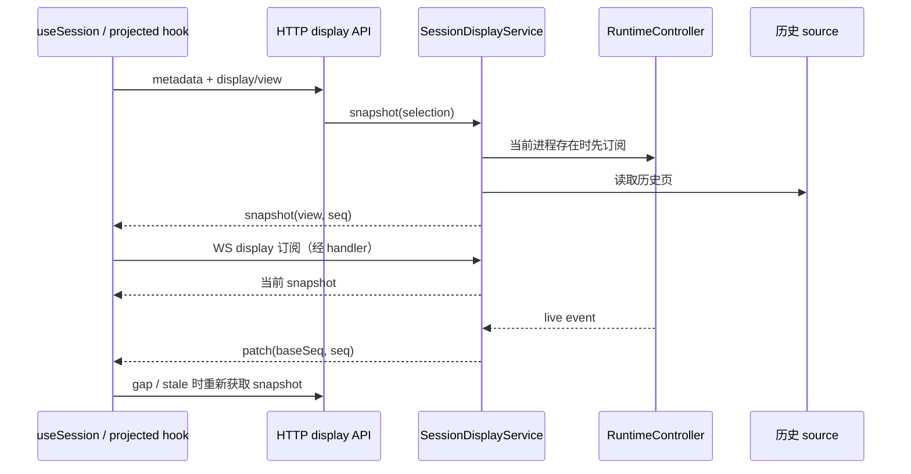

# 五条关键流程

[返回总览](README.md)。选择依据：F1 覆盖命令与执行，F2 覆盖历史/实时读链，F3 覆盖人工介入及多入口竞争，F4 覆盖 provider 原生历史语义，F5 覆盖跨项目/跨设备的监督循环。这五条来自实际页面/API，不代表所有外部集成都已追通。

**验证口径：本页只确认源码路径并阅读相关测试的安排与断言，所有测试均未执行。** 测试名中出现 native/bridge 等词不代表用了真实服务，下文分别说明替身边界。主 API 的 host/auth/custom header 与 WS upgrade 条件统一见 [modules.md](modules.md#权限与运行边界)。

## F1：创建、上传附件并启动 agent

**入口与结果**：`/new-session` → `NewSessionForm`，用户输入 prompt、provider、model、权限及可选文件。成功后导航到项目下的 session，带初始 process/permission 状态；API 自身还可能返回排队或错误。

1. 无待上传文件时，表单调用 `api.startSession` → `POST /api/projects/:projectId/sessions` → `SessionCommandService.start`。有文件时先 `api.createSession` → `.../sessions/create`，获得真实 session ID，再通过 `connection.upload` → `uploadFile/uploadChunks` 使用独立的 `.../upload/ws` WebSocket 上传，最后 `api.queueMessage` 发首条 prompt。
2. command 检查 provider 是否允许/退役、project ID、目录存在、prompt/权限/模型参数；`resolveStartCwd` 可根据已有 session 目录恢复失效项目路径。`prepareNewSession` 组装 model、gateway、MCP、executor 等配置。
3. `RuntimeController.startSession/createSession` 将请求交给 embedded Supervisor，或通过 HTTP 到 external runtime。`Supervisor.tryReserveWorkerStart` 预留容量，满载则排队或返回 immediate unavailable；`finally` 释放启动预留。
4. provider 被 registry 解析，`Process` 消费 `AgentSession.iterator`，维护当前状态与消息 buffer。原生 provider 负责主要会话持久化；Supervisor 发 session-created/ownership 等事件。
5. command 对成功结果写 provider、权限、账号/网关等 metadata 和 origin；表单清草稿并导航，F2 接管显示。新会话初始 ID/原生 ID 变化由 Supervisor callback 与 metadata remap 协调。

**数据变化**：provider 会话、进程内队列/映射、Yep metadata、uploads、runtime journal；不是一次跨存储事务。create-only 已成功而后续上传/发送失败时，不能推断“没有创建任何 session”。

**异常分支已核查**：

- API 队列满 → `mapAdmissionFailure` 返回 503；可排队 → 202 + queueId。当前表单用 `requireStartedHistoricalEdit(..., "session start")` 处理 202，尝试取消后报告失败；取消结果不确定时阻止再次提交，避免重复创建。**API 排队能力不等于当前新建 UI 展示一个等待中的 session。**
- 单个附件上传失败：toast 报错、继续其他附件，随后用成功上传的集合发送；不是全批次原子失败。
- provider 禁用/退役或参数无效在 runtime 调用前拒绝；实际 CLI/网络/模型失败仍属于 provider 异步结果，不可只以 HTTP 启动成功认定任务完成。

**源码证据**：

- [packages/client/src/components/NewSessionForm.tsx](../../packages/client/src/components/NewSessionForm.tsx) `NewSessionForm` 的 `pendingFiles` 双阶段分支、`sessionStartOutcomePending`；[packages/client/src/lib/sessionBranching.ts](../../packages/client/src/lib/sessionBranching.ts) `requireStartedHistoricalEdit`。
- [packages/server/src/routes/sessions.ts](../../packages/server/src/routes/sessions.ts) `createSessionsRoutes` 的 start/create handler；[services/SessionCommandService.ts](../../packages/server/src/services/SessionCommandService.ts) `start/create/prepareNewSession/mapAdmissionFailure/persistNewSessionMetadata`。
- [supervisor/Supervisor.ts](../../packages/server/src/supervisor/Supervisor.ts) `startSession/createSession/startProviderSession/registerProcess`；[sdk/providers/types.ts](../../packages/server/src/sdk/providers/types.ts) `AgentProvider/AgentSession`；[uploads/manager.ts](../../packages/server/src/uploads/manager.ts) `UploadManager`；[packages/client/src/api/upload.ts](../../packages/client/src/api/upload.ts) `uploadFile/uploadChunks/buildUploadUrl`。

**测试源码覆盖**：[packages/server/test/services/SessionCommandService.test.ts](../../packages/server/test/services/SessionCommandService.test.ts) `starts one native Codex turn and persists lifecycle metadata` 用 mocked RuntimeController/metadata，断言 command 参数与 writer 调用；`maps immediate create rejection without accepting queue ownership` 断言 503 与 requireImmediate 传递。它们不验证真实 Codex 创建、文件上传或页面跳转。附件部分失败和真实 session materialization 仍需后续端到端验收。

## F2：打开会话、接实时输出、断线后恢复显示

**入口与结果**：`/projects/:projectId/sessions/:sessionId` → `SessionPage/useSession`。默认显示投影；URL `history=legacy` 是显式退回旧消息路径。新投影返回按问题/工具组组织的内容和轻量状态，工具正文按需取。折叠工具合集的轻量状态可含累计耗时 `durationMs`/`timedCount`。

图只表示逻辑依赖；HTTP 初始读取与 WS 订阅可能竞速，不能据此假定网络到达顺序。

1. `useSessionMessages` 互斥启用 projected 或 legacy hook。projected 保存按 session/branch 区分的 snapshot；metadata 与 display 可并行获取，不要求完整工具正文先到。
2. `/display/view` 调 `SessionDisplayService.snapshot`；source 由 `registerSessionDisplayRoutes` 注入。`initialize` 在有 resident process 且非显式历史分支时先订阅 runtime，再读历史，避免读取期间漏 live tail。
3. source 解析 project/provider。Codex 可走 `CodexAppServerHistoryReader.getSemanticTurnsPage`；不可用时读取 provider history，带 revision/cursor/coverage；reader 页数、消息量有界。旧 `/sessions/:id` 详情接口另有 canonical overlay/fallback，不是默认新 display 的同义入口。
4. service 的 reducer 合并历史与 live，发 `display-snapshot/display-patch`；默认保留少量 active views，短期缓存 details。无 live subscription、非稳定 ID provider 或 settled 状态等条件下，`poll` 刷新文件历史；runtime journal 用于补播，具体路径依 provider 而异。
5. 客户端按 session、branch、epoch、sequence 验收 patch，另加载 older pages、tool group/detail/output；展示层不需要把全部原始工具结果常驻浏览器。

**异常分支已核查**：旧 revision/cursor 返回 409 `SESSION_DISPLAY_STALE`；跨来源游标也不能复用。patch baseSeq 有 gap 时不猜删除哪些节点，而是请求 snapshot。初始持续冲突有有限重试，后续 WS snapshot 可清除错误；非相关 404 不反复重试。服务端 poll 失败发 `display-sync: retrying` 后继续，不能把缓存内容当成“已同步”。

**权限、缓存和外部依赖**：走共同 API/upgrade 边界；Codex history 依赖 app-server 或文件；session/branch cache 与 journal 的保留期不同。历史 branch 不应订阅主分支的实时输入作为自己的事实。

**源码证据**：[packages/client/src/pages/SessionPage.tsx](../../packages/client/src/pages/SessionPage.tsx) `displayHistoryEnabled`；[hooks/useSessionMessages.ts](../../packages/client/src/hooks/useSessionMessages.ts) `useSessionMessages`；[hooks/useProjectedSessionMessages.ts](../../packages/client/src/hooks/useProjectedSessionMessages.ts) `handleDisplayEvent/refreshSessionMessages`；[packages/shared/src/session-display.ts](../../packages/shared/src/session-display.ts) `applySessionDisplayPatch`；[packages/server/src/routes/session-display.ts](../../packages/server/src/routes/session-display.ts) `registerSessionDisplayRoutes/createSessionDisplaySource/staleDisplayError`；[display/SessionDisplayService.ts](../../packages/server/src/display/SessionDisplayService.ts) `initialize/refresh/poll/subscribe/detail`。

**测试源码覆盖**：

- [packages/server/test/routes/session-display.test.ts](../../packages/server/test/routes/session-display.test.ts) `returns only the selected group details and rejects an old revision`：Hono 内部 request + 构造历史 source，断言只含选中工具组、旧 revision 返回 409；同文件另有真实 Codex rollout/Pi reader fixture 用例，仍不是运行中的 CLI。
- [packages/client/src/hooks/__tests__/useProjectedSessionMessages.test.ts](../../packages/client/src/hooks/__tests__/useProjectedSessionMessages.test.ts) `resynchronizes a sequence gap instead of guessing which nodes to remove`、`stops retrying persistent display conflicts and recovers when WS supplies a snapshot`：mock API/stream，断言重取与恢复；没有真实断网或页面视觉验证。

**断点/缺证据**：未测生产 tunnel 时延、内存峰值、external shell 重启后的回放，也未验证每个 provider 的历史与实时完全等价。

## F3：工具审批、竞争回答与通知

**入口与结果**：provider 的 pending input → 页面 `ToolApprovalPanel/QuestionAnswerPanel` 或通知/飞书入口 → 接受后 agent 继续；冲突或陈旧操作返回明确错误。

1. `Process` 接到输入请求进入 waiting-input；Codex bridge 也可能独立持有请求。`GET /api/sessions/:sessionId/pending-input` 经 command service 调 interaction service；即使存在 owned process，没有 process pending 也会继续找 bridge。
2. interaction service 在每 session 串行注册时重读 pending state，调用 `InteractionBroker.register`，绑定持有者与 provider resolver。broker 保存操作身份/版本和终态，resolver 本身不落盘。
3. 页面 `api.respondToInput` 发 requestId、response、可选答案/feedback。完整操作 ID/version 是服务端接受的另一种请求形式，必须成对；**当前基础 Web helper 没有发送这两个字段**，服务端用注册结果补齐。
4. `respondToInput` 校验答案、选择匹配的 process/bridge、规范 provider response；broker 在串行 claim 中比较版本并持久化，再调用赢得 claim 的 resolver。process 路径经 runtime respond，bridge 路径发给提供请求的 bridge controller。
5. 接受后 broker 终结操作；`approve_accept_edits` 还会持久化对应权限变更。后续状态事件更新 UI，PushNotifier 发 dismiss 或后续提醒。
6. 通知是平行链：EventBus → `PushNotifier.handleProcessStateChange` → PushService / NativePushService；按 request ID 去重，过滤已连接 browser profile。用户问题通知不携带可一键批准的 requestId，要求进入页面填答案。

**异常分支已核查**：重复回答/旧版本返回 409；缺必答题返回 400；有身份的 provider 拒绝可返回 502。broker 重启恢复会将未终结操作 fail closed，已 claim 的请求不盲目重发；未 claim 请求可被重新观察并注册。推送失败清理本次去重状态，使同 request 可重试，旧异步结果不应覆盖新请求。

**数据与权限**：审批写 `interactions/operations.json`，权限可能另写 metadata；通知订阅与通知状态另存。Web cookie/desktop token 和飞书账号/用户授权是不同边界；broker 防竞争不替代身份验证。

**源码证据**：[packages/server/src/interactions/SessionInteractionService.ts](../../packages/server/src/interactions/SessionInteractionService.ts) `respondToInput/selectPendingInputOwner/registerPendingInteraction`；[InteractionBroker.ts](../../packages/server/src/interactions/InteractionBroker.ts) `initialize/resolve`；[push/PushNotifier.ts](../../packages/server/src/push/PushNotifier.ts) `handleProcessStateChange/sendPendingInput`；[packages/client/src/api/client.ts](../../packages/client/src/api/client.ts) `respondToInput`；[packages/client/public/sw.js](../../packages/client/public/sw.js) `notificationclick` 及审批请求；[channels/feishu/channel-runtime.ts](../../packages/server/src/channels/feishu/channel-runtime.ts) `doStart`。

**测试源码覆盖**：[packages/server/test/interactions/SessionInteractionService.test.ts](../../packages/server/test/interactions/SessionInteractionService.test.ts) `serializes competing channel claims before invoking a process` 用被 gate 阻塞的 mock provider response 制造竞争，检查调用与冲突；[InteractionBroker.test.ts](../../packages/server/test/interactions/InteractionBroker.test.ts) 覆盖重启、超时、别名、坏存储；[push/PushNotifier.test.ts](../../packages/server/test/push/PushNotifier.test.ts) `allows retrying the same request after a failed send` 等使用 mock 投递器。未验收真实模型审批、手机锁屏操作或 Feishu 卡片权限。

## F4：编辑 Codex 历史 prompt，保留源会话并分叉

**入口与结果**：SessionPage 选择历史 prompt 编辑；成功导航到新的原生 session，源会话历史保留。名字为 `rollbackNumTurns` 的 API 字段在本路径实际用于计算 fork 排除范围。

1. `SessionPage` 从 persisted message/display question 提取 messageId、timestamp、原文和客户端排除 turn 数；`resolveSessionEditSubmission` 选择 `codex-fork`。
2. `api.resumeSession` → resume API → `SessionCommandService.resume`。若有 rollbackTarget，服务端读 branch state，用 `computeCodexRollbackNumTurns` 重算；读取/解析失败保留客户端 fallback 并记日志。
3. command 要求 source-preserving fork **立即 admission**，避免历史编辑进入不确定队列；继承源会话固定的 Codex account、model source、MCP、权限。Supervisor/provider 接收 resume ID 与排除数。
4. `CodexProvider.loadCodexForkBoundary` 读取有界的倒序 turn 后缀。存在保留 turn 时，发 `thread/fork`，以 `lastTurnId` 指定**包含该 turn**的边界；保留有效 config/MCP，并检查新 ID 不等于源 ID。
5. 编辑第一个 prompt、没有任何保留 turn 时，当前实现用 `thread/start` 创建空子会话，Yep metadata 补充 lineage。成功后清除源 active-turn 身份，修改后的 prompt 在 child 上启动 turn，避免 steer 回源会话。
6. command 写 `forkParentSessionId/forkTargetMessageId/forkFamilyTitle` 等关系并继承凭据；页面清源页面的临时输入，跳转新 session，再刷新分支信息。

**异常分支已核查**：分页重复 cursor/turn、缺失边界、边界还 in-progress 或超安全限额 → fail closed，不发 fork/turn start。服务端明确拒绝前可恢复编辑；POST 网络结果不确定时，`shouldRestoreHistoricalEditAfterFailure` 不自动让用户重试同一 fork。旧服务返回 queued 时 helper 尝试取消，取消未确认则保留“不确定”状态。

**参考与限制**：仓库参考 [references/codex/codex-rs/app-server-protocol/src/protocol/v2/thread.rs](../../references/codex/codex-rs/app-server-protocol/src/protocol/v2/thread.rs) `ThreadForkParams` 明确 last_turn_id 为 inclusive、不能在进行中；before_turn_id 为 experimental。它支持这里的边界解释，但不证明本机或远端 CLI 正在跑同一版本。本轮未启动 app-server。

**源码证据**：[packages/client/src/pages/SessionPage.tsx](../../packages/client/src/pages/SessionPage.tsx) `editSubmission.kind === "codex-fork"`；[lib/sessionBranching.ts](../../packages/client/src/lib/sessionBranching.ts) `resolveSessionEditSubmission/requireStartedHistoricalEdit/shouldRestoreHistoricalEditAfterFailure`；[packages/server/src/services/SessionCommandService.ts](../../packages/server/src/services/SessionCommandService.ts) `resume/inheritThreadCredentials`；[sessions/codex-rollback.ts](../../packages/server/src/sessions/codex-rollback.ts) `computeCodexRollbackNumTurns`；[sdk/providers/codex.ts](../../packages/server/src/sdk/providers/codex.ts) `loadCodexForkBoundary`、`codex_thread_fork_requested/completed` 分支。

**测试源码覆盖**：[packages/server/test/sdk/providers/codex.test.ts](../../packages/server/test/sdk/providers/codex.test.ts) `forks through stable lastTurnId without losing thread MCP config or the Fast opt-out`、`loads only the paginated suffix needed for a cross-page fork boundary`、`fails closed when paginated fork history repeats a cursor or page` 使用生成的 fake app-server 子进程捕获协议；后者断言未发送 thread/fork 和 turn/start。它比只 mock provider 方法更接近传输层，但仍不证明真实 Codex 版本兼容。客户端 helper 测试位置：[packages/client/src/lib/__tests__/sessionBranching.test.ts](../../packages/client/src/lib/__tests__/sessionBranching.test.ts)。

## F5：查看收件箱，打开会话后跨客户端更新已读

**入口与结果**：`/inbox`、Sidebar badge、会话页面可见性。用户看到优先分层；打开可见会话后，服务端已读记录更新，其他客户端接事件重新聚合。

1. `InboxProvider` 拉 `/api/inbox`；`createInboxRoutes` 聚合项目/catalog、reader/index、metadata、runtime 和 active bridge view。已归档排除；非活跃且过旧项目可提前跳过，tier 每组返回有上限。
2. pending input 优先 needsAttention，其次 in-turn active、最近活动、8h/24h unread。一个 session 只进最高匹配层。`badgeSessionIds` 来自 needsAttention；`finishedUnreadCount` 独立统计 24h 内未读且非 pending/in-turn 会话，并在截断前计数。
3. `SessionPage` 调 `useEngagementTracking`：页面可见且有活动/未读时 `api.markSessionSeen(sessionId, updatedAt)`；后台页面不自动清新未读。activityAt 用于触发，updatedAt 用于提交，二者不可随意互换。
4. mark-seen API 调 `NotificationService.markSeen`，取提供时间与服务端现在的较大值，并保持 lastSeen 不倒退，清 needsReview，**先更新内存并发 `session-seen`，再 await 保存 `notifications.json`**。客户端只在请求成功后更新本次已提交活动标记；广播不等于落盘确认。
5. `InboxProvider` 从 activityBus 接 process/status/seen/created 事件，合并延迟刷新；PushNotifier 对 seen 事件撤销提醒。最近访问还可在启动时回填缺失 read markers，但不会把历史 visitedAt 全升级成现在。

**异常分支已核查**：没有 NotificationService 时 mark-seen 返回 503；坏 JSON 在 `NotificationService.initialize` 告警后以空状态启动，可能使旧内容重新未读。保存失败会抛错，但内存状态和广播已经改变；客户端不标记本次提交完成，后续是否重新持久化还取决于再次触发及状态变化，不能把其他页面已刷新当作落盘成功。没有证明多客户端时钟偏差和所有断网时序都已处理。

**源码证据**：[packages/server/src/routes/inbox.ts](../../packages/server/src/routes/inbox.ts) `createInboxRoutes` 的 tier/badge/finishedUnreadCount；[notifications/NotificationService.ts](../../packages/server/src/notifications/NotificationService.ts) `initialize/markSeen/recordSeen/importLastSeenFromRecents`；[routes/sessions.ts](../../packages/server/src/routes/sessions.ts) mark-seen handler；[packages/client/src/hooks/useEngagementTracking.ts](../../packages/client/src/hooks/useEngagementTracking.ts) `useEngagementTracking`；[contexts/InboxContext.tsx](../../packages/client/src/contexts/InboxContext.tsx) `InboxProvider`。

**测试源码覆盖**：[packages/server/test/routes/inbox.test.ts](../../packages/server/test/routes/inbox.test.ts) 用 mocked scanner/readers/runtime/notification 检查分层、archived 排除、inactive bridge 不算 active，以及 `does not count notification-backed sessions needing review`；[test/notifications/service.test.ts](../../packages/server/test/notifications/service.test.ts) 使用临时 JSON 文件，检查持久化、坏 JSON、时间不倒退和 needsReview 清理。本轮没有多设备、真实页面可见性或通知投递验证。
